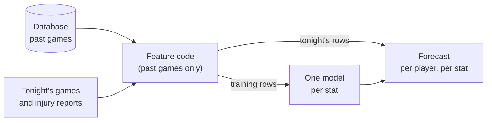

# NBA Stat Engine

Forecasts seven stats for every player in an NBA game: points, rebounds, assists, steals, blocks,
turnovers and three-pointers made. Each forecast is a distribution rather than a single number: an
expected value, a probability for each possible result (0, 1, 2, …), and ranges meant to contain
the actual result 80% and 95% of the time.

I built the whole pipeline. It pulls NBA data, builds features from each player's past games, trains one model per stat, and has a nightly forecast job that has so far run only on replayed past slates, because the 2026-27 season has not started.

**On a full season held out of all training, tuning and calibration (2024-25, 28,097
player-games), points forecasts are about 12% more accurate than a player's average over the
training seasons: they miss by 4.59 points per game on average, against 5.19.** Across all seven
stats, the 80% ranges contained the actual result between 78.8% and 79.9% of the time, and the 95%
ranges between 94.6% and 95.2%.

## Status

This is a first publication. The README and the two supporting documents come first:
[findings](docs/findings.md) and [data and limits](docs/data-and-limits.md). The code is going through a
review pass and will be published after it.

## Results


| Stat           | MAE   | MAE, player average | Reduction vs player average | CRPS  | 80% range hit rate |
| -------------- | ----- | ------------------- | --------------------------- | ----- | ------------------ |
| Points         | 4.586 | 5.186               | 11.6%                       | 3.220 | 78.8%              |
| Rebounds       | 1.905 | 2.079               | 8.4%                        | 1.334 | 79.5%              |
| Assists        | 1.341 | 1.461               | 8.2%                        | 0.918 | 79.9%              |
| Turnovers      | 0.888 | 0.933               | 4.7%                        | 0.586 | 79.8%              |
| Three-pointers | 0.888 | 0.932               | 4.8%                        | 0.588 | 79.0%              |
| Steals         | 0.711 | 0.727               | 2.2%                        | 0.451 | 79.8%              |
| Blocks         | 0.521 | 0.524               | 0.5%                        | 0.302 | 79.4%              |


- MAE (mean absolute error) is the typical miss of the expected value, in the stat's own units
(points for points, rebounds for rebounds). The baseline is each player's average over the
training seasons, a fixed number per player.
- Reduction vs player average is how much smaller the model's typical miss is than that
baseline, worked out from the unrounded MAE values, so it can differ by a tenth from the
rounded columns.
- CRPS (continuous ranked probability score) scores the whole forecast distribution rather than
just its center, so it also rewards a well-sized spread. It is a standard score for probabilistic
forecasts ([why I use it](docs/findings.md#12-why-crps)).
- 80% range hit rate is how often the actual result landed inside the 80% range. The target is 80%.

Lower is better for MAE and CRPS. The models train on the other three seasons (2022-23, 2023-24 and
the 2025-26 regular season), so 2024-25 is unseen but not strictly later than the training data; the strictly
chronological checks are in [How it is validated](docs/findings.md#13-how-it-is-validated). The full
table, with the 95% ranges, the last-five-games baseline and the source of these numbers, is in
[Results](docs/findings.md#11-results).

The gain over the player average runs from about 12% on points down to under 1% on blocks, measured
on the expected value. Resampling players 5,000 times puts a 95% interval of 10.1% to 13.2% on the points gain. Against the tighter last-5-games baseline the gain on points is about 5% (4.59 against 4.83); the full table is in findings. Blocks are effectively a tie there: a player records zero blocks in about 69%
of games, which leaves little to predict. The gain on steals is also small, about 2%. I compare by
MAE and CRPS and do not quote a CRPS skill score (the percent improvement in CRPS over a baseline) for the five
hurdle-modeled stats, because its baseline cannot predict an exact zero and would make the model look better than it is
([why](docs/findings.md#12-why-crps)).

For a concrete forecast, here is the first row of the evaluation file: LeBron James in the 2024-25
opening game, Lakers against Timberwolves. For three-pointers made, the model gave an expected value of
1.86 and these probabilities (rounded, so they add up to slightly over 100%):


| Made        | 0   | 1   | 2   | 3   | 4   | 5   | 6 or more |
| ----------- | --- | --- | --- | --- | --- | --- | --------- |
| Probability | 22% | 22% | 29% | 16% | 7%  | 3%  | 3%        |


The 80% range is 0 to 2 made, and he made 1. That range holds 73% of this forecast's own probability,
not 80%. Results come in whole numbers, so a range grows in chunks (0 to 3 would hold 89%), and the
cut points are fitted so that over many games about 80% of results land inside. The 22% for zero is its
own probability, which is what the hurdle form is for. For assists the same row gave an expected value
of 8.2 and an 80% range of 4 to 10, and he had 4.

The 2026-27 season has not started, so no live forecast could be scored yet. Until then the nightly
pipeline has been rehearsed end to end on replayed past slates, and every figure above comes from
held-out games.

## How it works




1. Data. Box scores, schedules and official inactive lists for four seasons (2022-23 to 2025-26),
  pulled from the NBA's public stats endpoints, plus injury reports from a public feed, which
   start in March 2026. Everything is stored in a local DuckDB database.
2. Features. For each player and game, features are built from games played before it (two known
  exceptions are listed in findings 1.4): recent form, rest, the opponent, and how usage shifts when
   teammates are out. Three time-series models track a player's underlying form: an unscented Kalman filter (a smoothed estimate of their current level and trend), an INGARCH count model (expected volume that updates after each game) and a hidden Markov model (whether they are in a hot, normal or cold stretch). Using anything from the game itself or later would make the model look better
   offline than it is live. That mistake is called data leakage.
3. Models. One [NGBoost](https://github.com/stanfordmlgroup/ngboost) model per stat. NGBoost is
  a gradient-boosting method that predicts a distribution instead of a single number. Points and
   rebounds use a Normal (bell-curve) distribution. Assists, steals, blocks, turnovers and
   three-pointers are often exactly zero, so they use a hurdle model: a classifier for whether the
   stat is above zero, and a LogNormal distribution for how big it is when it is. That gives zero
   its own probability instead of spreading it over nearby values. An earlier two-layer stack (three XGBoost models per stat, combined by an NGBoost model) trailed this on all seven stats when the walk-forward results were pooled.
4. Ranges and nightly run. The 80% and 95% ranges are cut from the same probability table each
  forecast publishes, at points tuned so that over many games they hit 80% and 95%, so a range always
   agrees with its own forecast. Tonight's rows are built with
   the same feature code as the training rows, so there is one implementation instead of two that
   can drift apart.


## More detail

The rest is in two documents, each summarized here.

### Findings

I kept the 2024-25 season out of all training, tuning and calibration, and judged every change with
walk-forward validation: train only on games before a test window, score that window, then move
forward in time. A change was kept only if it improved CRPS by at least 0.5% across several
windows, with one exception: moving four stats to a single model, which was never significantly behind. Along the way I found and fixed several leaks, where a feature used information from after
the game being predicted; fixing them made every model about 2% worse (0.6% to 0.7% on points and rebounds), as expected
once a leak is gone. One model per stat, trained on all the features, beat my earlier two-layer stack,
while ideas like referee tendencies and an expected-minutes model did not help. The reasons for each
call are in [docs/findings.md](docs/findings.md).

### Data and limits

Box scores, schedules and inactive lists come from the NBA's public stats endpoints through the
open-source [nba_api](https://github.com/swar/nba_api) client, and injury reports from a public
feed. Everything is stored in a local DuckDB file that is not committed. The main limits are that a
50% range exists only for points, and that the inactive lists (who was ruled out) are empty at the
source for 20 games of the 2024-25 playoffs, so the absence features under-count there. Box scores
are also missing for 154 games, including the whole 2025-26 playoffs. These and the other limits, with possible fixes, are in
[docs/data-and-limits.md](docs/data-and-limits.md).

## What I learned and what's next

Most of the work went into making sure the scores meant something. Finding and fixing data leaks made  
every model about 2% worse and taught me to distrust a result that looks too good. A simpler design  
(one model per stat) beat a more complex one. And the failures that mattered were silent: a data pull  
that kept reporting success while it returned nothing.

  
The first live slates of the 2026-27 season will be the real test. On my list are refitting the assists  
95% range, defining an expected roster before the game, and finding a better-documented injury source.

## Running it

The code is not published yet, so this section applies once it is.

Python 3.13.

```bash
pip install -r requirements.txt pytest httpx   # runtime, plus the test runner and the API test client
cp .env.example .env                           # the model settings the results were produced with
python -m pytest tests/ -q                     # runs without data/: the few tests that need it skip
```

Everything beyond the tests needs the database and trained models under `data/`. They are not
committed. On my machine the database is about 380 MB and the models folder about 300 MB, including older backup copies (about 100 MB without them). A from-scratch
backfill makes about 6,700 requests, capped per run and resumable, and I have not timed a full one. `src/pipeline/backfill.py` pulls 2022-23 to 2024-25 from the NBA
endpoints by default; for 2025-26, set `CURRENT_SEASON=2025-26` in `.env` and pass
`--seasons 2022-23 2023-24 2024-25 2025-26`. The models come from a retrain. With both in place:

```bash
python -m src.pipeline.daily                  # nightly pipeline
python scripts/eval_forecast_calibration.py   # re-scores the serving models on the 2024-25 holdout
uvicorn src.api.main:app                      # API
make rehearse                                 # nightly run against a copy of the database
```

Retraining does not reproduce the results table to the last digit, because NGBoost training is not
bit-reproducible; the scoring command above re-scores the saved models instead.

`make help` lists the rest: data checks, retrains and the evaluation gates. A `Dockerfile` for a
runtime image is included. `requirements.lock` pins the environment the results were produced in, and
`make install-lock` installs from it.

## Repository layout

```
src/
  ingestion/   data pulls: games, player logs, inactive lists, injury reports
  features/    feature building
  lineup/      usage redistribution when teammates are out
  quant/       the time-series models (Kalman filter, count model, regime model)
  db/          database schema and write validation
  ensemble/    the models, the hurdle component, the check that adopts a model, walk-forward evaluation
  pipeline/    nightly run, serving, retraining, parity checks
  api/         FastAPI service: forecast, player and matchup endpoints
tests/         test suite, including the leakage tests
scripts/       evaluation, audits, rehearsals, benchmarks
docs/          findings, data and limits
```

